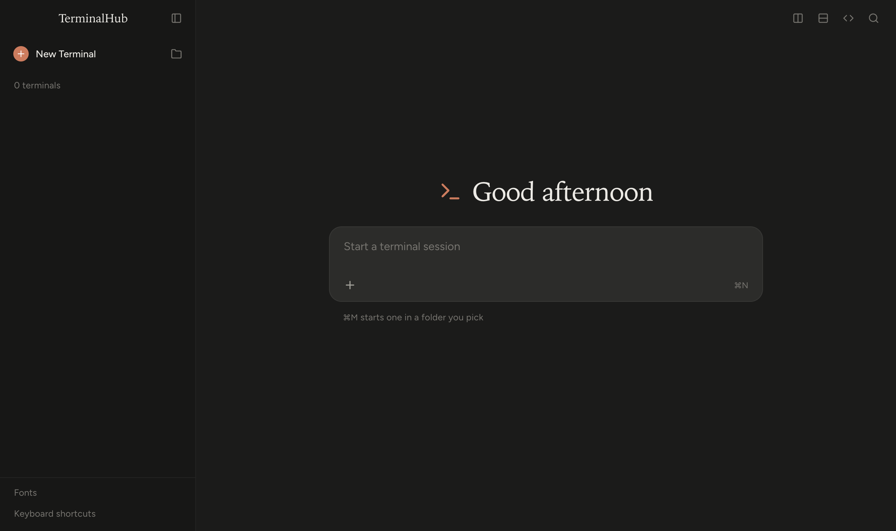
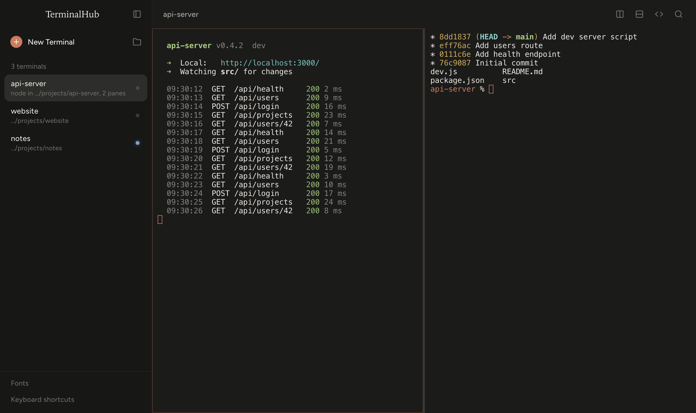
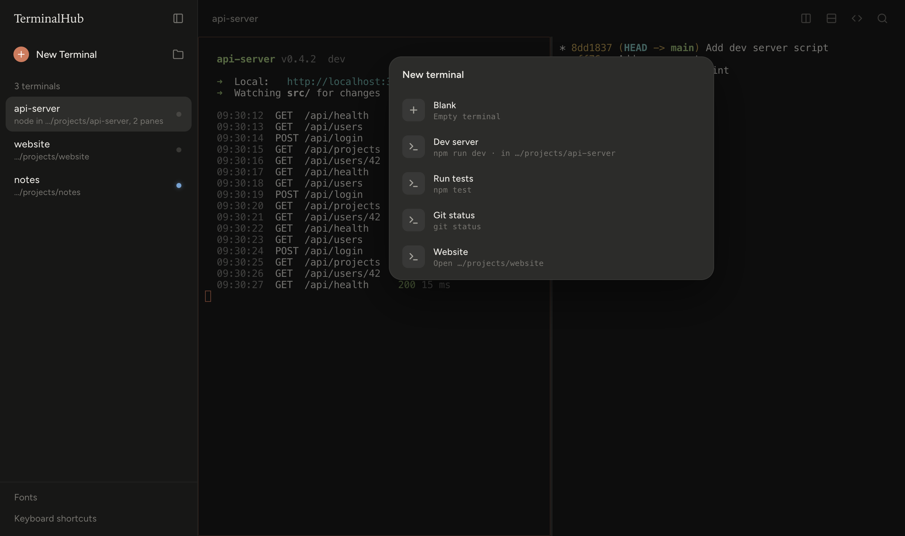
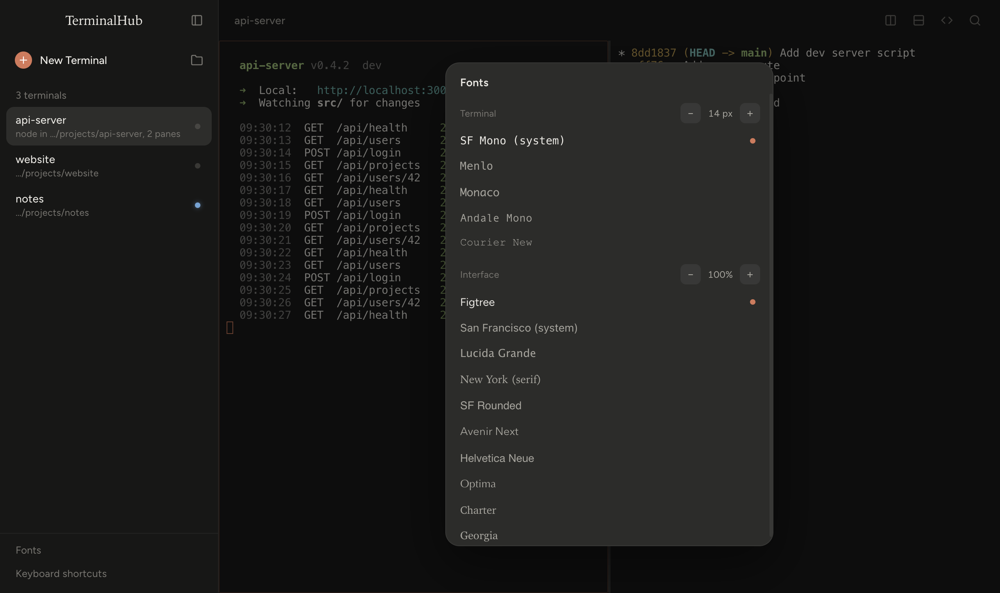

<div align="center">



# TerminalHub

**All your terminals in one calm window.**

A terminal app for macOS with a sidebar of tabs, split panes, snippets, and tabs that come back after a restart.

[](https://github.com/MohdAbuRezeq/TerminalHub/actions/workflows/ci.yml)
[](LICENSE)
-lightgrey.svg)

[](https://github.com/MohdAbuRezeq/TerminalHub/releases/latest)

</div>



## Why

Most days end with a dozen terminal windows and no idea which one is running what. TerminalHub keeps them in one window, names each tab after its folder and the program running in it, and tells you when a tab you are not looking at has finished.

It is built for people who run long tasks in several tabs at once: dev servers, test runs, builds, and coding agents such as Claude Code.

## Features

**Tabs you can find again**

- A sidebar of tabs. Each one shows its folder and what is running there, for example `api-server` with `node in …/projects/api-server` below it.
- Tabs come back after a restart, with their folders, names, order and split panes.
- Jump with `⌘1` to `⌘9`, or drag tabs to reorder them.
- Double-click a tab to give it your own name.

**Know when work is done**

- A background tab that finishes gets a blue dot, a Dock badge and a macOS notification.
- A tab that is producing output shows a pulsing dot.
- Turn notifications off under **View > Notify When a Tab Finishes**.

**Split panes and snippets**

- Split a tab side by side or top and bottom, and drag the divider to resize.
- Save commands you type often as snippets. A snippet can also carry a folder, so one click opens a tab in the right place and runs the command.

**Comfortable to type in**

- Click anywhere on the line you are typing to move the cursor there.
- Select text on that line and press Backspace to delete it.
- `⌘A` selects what you are typing, also inside full-screen programs. Press it again to select everything.
- Option-key characters work on non-US keyboards (`@`, `[`, `]`, `|` on German layouts).
- Drop a file onto a pane to paste its path.

**Fonts and languages**

- Choose the terminal font and the interface font, and set a size for each.
- Arabic and Hebrew are drawn with a monospace font and read right to left.

**Everyday terminal things**

- Search through a tab's output with `⌘F`.
- Links in the output are clickable.
- Open a new tab straight in a folder you pick, with `⌘M`.
- Copying text tidies it up: trailing spaces are dropped, and a long line that wrapped on screen is copied as one line.
- 10,000 lines of scrollback per pane.
- Hide the sidebar when you want the whole window for the terminal.
- Long tasks keep running at full speed when the app is in the background.

**Safe by default**

- Quitting the app, closing a tab and deleting a snippet all ask first.
- The window remembers its size, position and full-screen state.

<table>
<tr>
<td width="50%"></td>
<td width="50%"></td>
</tr>
<tr>
<td align="center">Start a tab from a snippet</td>
<td align="center">Pick fonts and sizes</td>
</tr>
</table>

## Install

**Download**

1. Get the latest zip from the [Releases page](https://github.com/MohdAbuRezeq/TerminalHub/releases/latest).
2. Open the zip and drag **TerminalHub.app** into your **Applications** folder.
3. Open it. The first time, macOS blocks the app because it is not signed with an Apple Developer certificate. Go to **System Settings > Privacy & Security**, scroll down, and click **Open Anyway**. On macOS 14 and older, right-click the app in Finder and choose **Open**.

You need a Mac with Apple Silicon (M1 or newer).

If you prefer the terminal, this removes the block:

```bash
xattr -dr com.apple.quarantine /Applications/TerminalHub.app
```

**Build from source**

You need Node.js 18 or newer and the Xcode Command Line Tools (`xcode-select --install`).

```bash
git clone https://github.com/MohdAbuRezeq/TerminalHub.git
cd TerminalHub
npm install
npm run package
```

The app is written to `dist/TerminalHub-darwin-arm64/TerminalHub.app`.

## Keyboard shortcuts

| Action | Shortcut |
|---|---|
| New tab | `⌘N` |
| New tab in a folder | `⌘M` |
| Close tab | `⌘W` |
| Rename tab | `⌘R` |
| Go to tab 1 to 9 | `⌘1` to `⌘9` |
| Next / previous tab | `⌘↓` / `⌘↑` or `⇧⌘]` / `⇧⌘[` |
| Split side by side | `⌘D` |
| Split top and bottom | `⇧⌘D` |
| Next / previous pane | `⌘→` / `⌘←` |
| Close pane | `⇧⌘W` |
| Find | `⌘F` |
| Clear terminal | `⌘K` |
| Snippets | `⇧⌘S` |
| Text size up / down / reset | `⌘=` / `⌘-` / `⌘0` |
| Select what you are typing | `⌘A` (press twice to select all) |
| Move the typing cursor | Click on the line, or `⌥`-click |
| Delete selected input | Select, then `⌫` |

## Develop

```bash
npm install     # also rebuilds node-pty for Electron
npm start       # bundle the renderer and launch the app
npm test        # run the unit tests
npm run package # build the .app into dist/
```

`npm install` runs `electron-rebuild` so that `node-pty` matches Electron's version of Node. If the first terminal fails to open with a native module error, run `npm run rebuild`.

### Project layout

```
main.js              Main process: window, menu, saved state, pty lifecycle
preload.js           The API the page is allowed to call (window.terminalAPI)
renderer/
  index.html         Page markup and content security policy
  styles.css         All styles
  renderer.js        Tabs, panes, sidebar, snippets, fonts, search
lib/                 Pure logic with no DOM or Electron, covered by tests
  line-edit.js       Click-to-move and select-and-delete on the input line
  tabs.js            Tab names, ordering, saved-tab validation
  shell.js           Which shell to start and how to quote paths
  divider.js         Split divider cleanup
  terminal-store.js  Which page owns which terminal
test/                Unit tests for lib/ (node --test)
docs/screenshots/    Images used in this README
```

The renderer is bundled with esbuild into `renderer/bundle.js`, which is not checked in.

### How it is built

- **Electron** for the window, **xterm.js** for drawing the terminal, **node-pty** for the shell processes.
- The page runs with `contextIsolation` on and `nodeIntegration` off. It can only reach the system through the small API in `preload.js`.
- A strict content security policy allows no remote content and no inline scripts.
- Terminal output is batched once per event-loop tick before it is sent to the page, which keeps the app responsive during noisy commands.
- Spawned shells get a clean environment. Variables that npm adds when the app is started from `npm start` are removed.

## Known limits

- **macOS on Apple Silicon only.** The shell setup and folder detection are POSIX, so Linux may mostly work, but it is untested. Windows would need changes to both.
- **Right-to-left text is partial.** Arabic and Hebrew lines read correctly, but they start at the left edge, and the cursor sits at the wrong end while typing.
- **Click and delete on the input line send keystrokes.** The shell owns the line, so the app sends arrow keys and backspaces on your behalf. Programs that read input without a line editor, such as password prompts, can receive those keys as text.
- **Restored tabs start fresh shells.** Programs that were running are not restarted.
- **No signed build.** macOS asks you to confirm the first launch. See the install steps above.

## Contributing

Bug reports, ideas and pull requests are welcome. Start with [CONTRIBUTING.md](CONTRIBUTING.md). It explains how to set up, what to test, and what makes a pull request easy to merge.

Please follow the [Code of Conduct](CODE_OF_CONDUCT.md). To report a security problem, see [SECURITY.md](SECURITY.md).

Changes for each version are listed in [CHANGELOG.md](CHANGELOG.md).

## License

[MIT](LICENSE) © Mohammad Abu Rezeq

You may use, change and share this software, including in commercial products, as long as you keep the copyright and license notice. It comes with no warranty.

TerminalHub includes third-party software and fonts under their own licenses. See [THIRD_PARTY_NOTICES.md](THIRD_PARTY_NOTICES.md).
